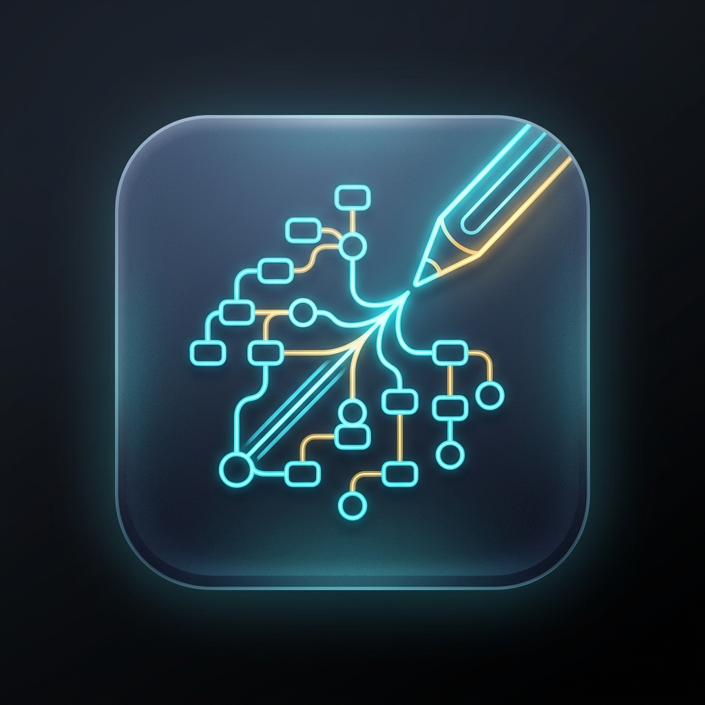
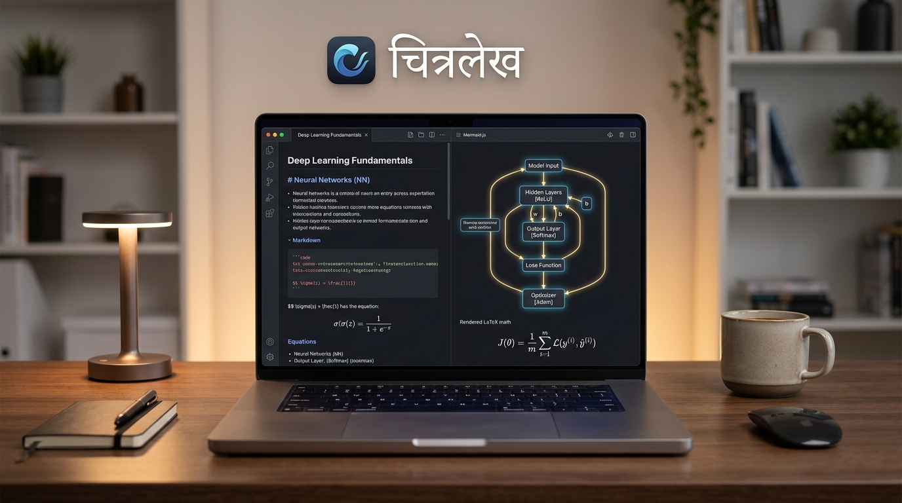
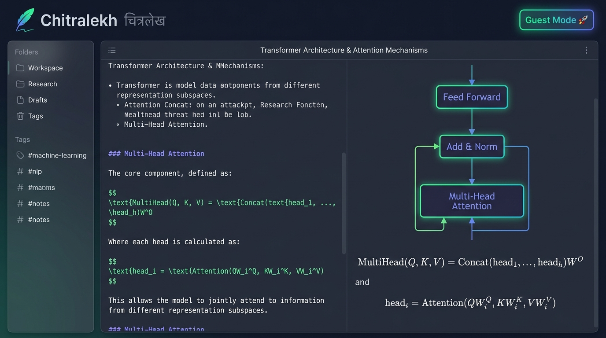
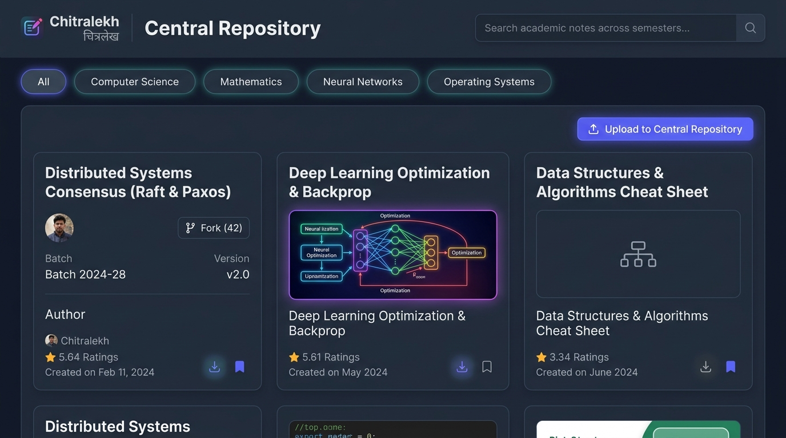
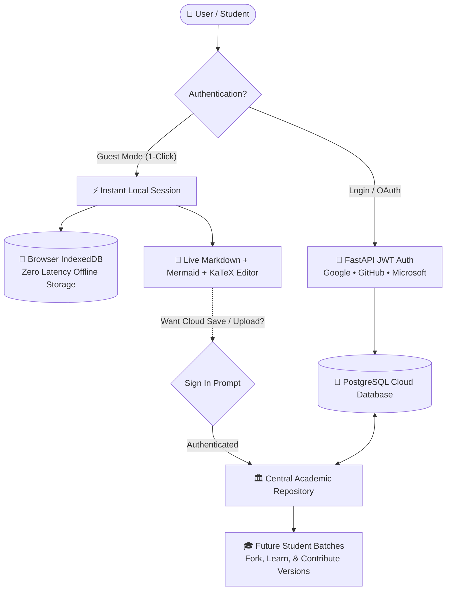

<p align="center">
  
</p>

<h1 align="center">Chitralekh (चित्रलेख)</h1>

<p align="center">
  <strong>The Visual Notes Studio & Academic Knowledge Repository</strong>
</p>

<!-- MOVING CHARACTERS / ANIMATED TYPING SVG -->
<p align="center">
  <a href="https://chitralekh-frontend.onrender.com">
    
  </a>
</p>

<p align="center">
  <a href="https://chitralekh-frontend.onrender.com"></a>
  <a href="https://chitralekh-backend-fj80.onrender.com/docs"></a>
  <a href="https://github.com/Ritik-453/Chitralekh/stargazers"></a>
  <a href="LICENSE"></a>
</p>

<p align="center">
  
  
  
  
  
  
  
  
</p>

---

## 🌟 The Philosophy behind "चित्रलेख" (Chitralekh)

> *"चित्रं च लेखं च यत्र मिलतः, तत्र ज्ञानं प्रकाशते।"*  
> *(Where imagery and mindful writing unite, knowledge illuminates.)*

The name blends two classical Sanskrit roots:
* **चित्र (Chitra)**: Visual imagery, blueprints, diagrams, and architecture.
* **लेख (Lekha)**: Mindful inscription, notes, documentation, and literature.

Every semester, students solve complex proofs, whiteboard system designs, and build study guides — yet **90% of that student knowledge vanishes** across batch transitions. **Chitralekh** transforms private ephemeral notes into persistent visual artifacts and a shared academic legacy.

---

## 📸 Visual Showcase

<p align="center">
  
</p>

<table width="100%">
  <tr>
    <td width="50%" align="center">
      <strong>💻 Visual Note & Flowchart Studio</strong><br/><br/>
      
    </td>
    <td width="50%" align="center">
      <strong>🏛️ Central Academic Repository</strong><br/><br/>
      
    </td>
  </tr>
</table>

---

## ✨ Core Superpowers

| Feature | Description | Status |
| :--- | :--- | :---: |
| ⚡ **Instant Guest Mode** | Try the full editor & diagrams in **1-click** with zero signup friction. Notes save to local IndexedDB. | ✅ Live |
| 📊 **Mermaid.js Flowcharts** | Real-time code-to-diagram engine for system architectures, algorithms, state machines, and mindmaps. | ✅ Live |
| 📐 **LaTeX Math Engine** | Native rendering for complex mathematical equations, proofs, and machine learning formulations. | ✅ Live |
| 🏛️ **Central Knowledge Hub** | Pass down curriculum notes across college batches. Search, study, like, and download community notes. | ✅ Live |
| 🔄 **Heritage & Version Forking** | Fork any peer note into your workspace or contribute updated versions (`v1 → v2`) preserving credit. | ✅ Live |
| 📷 **Document Scanner & OCR** | Convert physical whiteboard snaps, lecture PDFs, and paper docs into clean editable Markdown. | ✅ Live |
| 💾 **Local-First + Cloud Sync** | Draft zero-latency offline notes stored locally with instant cloud backup upon login. | ✅ Live |
| 🎨 **Theme & Customization** | Dark, Light, and Cyberpunk high-contrast themes with custom monospace fonts and split layouts. | ✅ Live |

---

## 🏗️ System Architecture



---

## ⚡ Quick Start

### 1. Try Live in Browser (Zero Setup)
No installation or signup required:
👉 **[Open Chitralekh Live](https://chitralekh-frontend.onrender.com)** and click **"Continue as Guest (Try app instantly) 🚀"**

---

### 2. Run Locally with Docker (Recommended)

```bash
# Clone the repository
git clone https://github.com/Ritik-453/Chitralekh.git
cd Chitralekh

# Configure environment variables
cp backend/.env.example backend/.env

# Spin up backend, frontend, database, and redis
docker-compose up -d

# Open in your browser:
# Frontend: http://localhost:5173
# Backend API: http://localhost:8000/docs
```

---

### 3. Local Development Setup

#### Backend (FastAPI + Python 3.12)
```bash
cd backend
python -m venv venv

# On Windows:
venv\Scripts\activate
# On Linux/macOS:
# source venv/bin/activate

pip install -r requirements.txt
alembic upgrade head
uvicorn app.main:app --reload --host 0.0.0.0 --port 8000
```

#### Frontend (React 18 + Vite + TypeScript)
```bash
cd frontend
npm install
npm run dev
```

---

## ⌨️ Productivity Keyboard Shortcuts

| Shortcut | Action | Description |
| :--- | :--- | :--- |
| <kbd>⌘</kbd> / <kbd>Ctrl</kbd> + <kbd>K</kbd> | **Global Search** | Instant full-text fuzzy note search |
| <kbd>⌘</kbd> / <kbd>Ctrl</kbd> + <kbd>N</kbd> | **New Note** | Instantiate a blank note with template picker |
| <kbd>⌘</kbd> / <kbd>Ctrl</kbd> + <kbd>S</kbd> | **Save Note** | Save locally (IndexedDB) or sync to cloud |
| <kbd>⌘</kbd> / <kbd>Ctrl</kbd> + <kbd>/</kbd> | **Toggle Split** | Switch between code, split, and full diagram preview |
| <kbd>⌘</kbd> / <kbd>Ctrl</kbd> + <kbd>B</kbd> | **Bold** | Format selected text as bold |
| <kbd>⌘</kbd> / <kbd>Ctrl</kbd> + <kbd>I</kbd> | **Italic** | Format selected text as italic |
| <kbd>⌘</kbd> / <kbd>Ctrl</kbd> + <kbd>E</kbd> | **Code Snippet** | Wrap inline code syntax |
| <kbd>⌘</kbd> / <kbd>Shift</kbd> + <kbd>F</kbd> | **Zen Mode** | Distraction-free fullscreen editor |

---

## 📂 Repository Organization

```
Chitralekh/
├── assets/                  # High-res UI mockups, diagrams, and media
├── backend/                 # FastAPI REST application
│   ├── app/
│   │   ├── api/v1/          # Endpoints: Notes, Folders, Repository, OCR, Flowcharts
│   │   ├── core/            # Config, Security, JWT & OAuth providers
│   │   ├── models/          # SQLAlchemy async ORM models
│   │   └── services/        # OCR Tesseract, WebP compression, Central repo logic
│   ├── alembic/             # Database migration revisions
│   └── requirements.txt
├── frontend/                # React 18 + TypeScript + Vite SPA
│   ├── src/
│   │   ├── components/      # UI components (Editor, Flowcharts, GuestBanner, Modals)
│   │   ├── context/         # AuthContext with 1-Click Guest Mode support
│   │   ├── hooks/           # useNotes, useEditor, useFlowcharts
│   │   ├── pages/           # NoteEditor, CentralRepository, Login, Dashboard
│   │   └── services/        # Axios API client & IndexedDB localStorageService
├── docker-compose.yml       # Multi-container orchestration
└── render.yaml              # Production Render Blueprint configuration
```

---

## 🤝 Contributing

Contributions make open-source an inspiring place to learn and build.
1. **Fork** the Project
2. Create your Feature Branch (`git checkout -b feat/AmazingFeature`)
3. Commit your Changes (`git commit -m 'feat: Add AmazingFeature'`)
4. Push to the Branch (`git push origin feat/AmazingFeature`)
5. Open a **Pull Request**

---

## 📜 License & Acknowledgments

Distributed under the **MIT License**. See [`LICENSE`](LICENSE) for details.

Crafted with ❤️ for students, researchers, and engineers by [Ritik](https://github.com/Ritik-453).

<p align="center">
  <a href="#chitralekh-चित्रलेख">⬆ Back to Top</a>
</p>